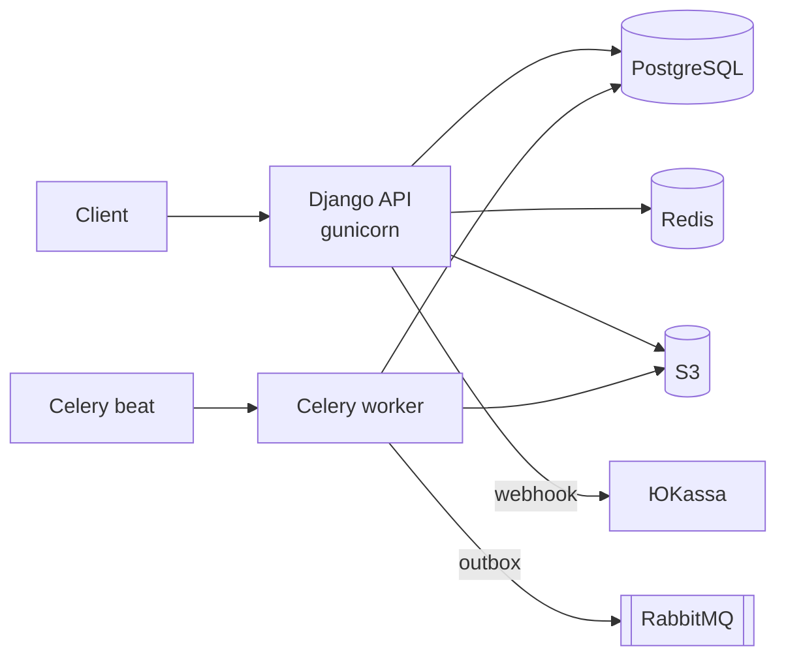

# B2B Supply Core

Backend B2B-платформы снабжения: поставщики публикуют каталог и остатки, покупатели оформляют заказы с резервированием товара и оплачивают их онлайн.

## Возможности

- **Организации и роли** — поставщики и покупатели, 5 ролей, приглашение сотрудников по email-ссылке.
- **Авторизация** — JWT (refresh в HttpOnly-cookie, blacklist в Redis), сброс пароля через OTP на почту.
- **Каталог** — товары, склады, остатки; полнотекстовый поиск по названию (`pg_trgm` + GIN), фильтры, пагинация.
- **Импорт прайс-листов** — загрузка `.xlsx` напрямую в S3 по presigned URL, обработка в Celery, отчёт по строкам с ошибками.
- **Заказы** — резервирование остатков под блокировкой строк, автоснятие просроченных резервов (1 час).
- **Платежи** — ЮKassa: идемпотентные запросы, webhook под Redis-локом.
- **События** — паттерн Transactional Outbox: `order.confirmed` гарантированно уходит в RabbitMQ.

## Стек

Python 3.12 · Django 6 · Django REST Framework · PostgreSQL 16 · Celery · RabbitMQ · Redis · S3 (MinIO / Yandex Object Storage) · Docker Compose · pytest · drf-spectacular

## Архитектура



Подробнее — в [docs/ARCHITECTURE.md](docs/ARCHITECTURE.md).

## Быстрый старт

```bash
cp .env.example .env
docker compose up --build
docker compose exec django-server python manage.py migrate
docker compose exec django-server python manage.py seed   # тестовые данные
```

Перед импортом прайс-листов создайте бакеты `public` и `private` в консоли MinIO (http://localhost:9001).

| Что | Адрес |
|---|---|
| API | http://localhost:8000/api/v1/ |
| Swagger / ReDoc | http://localhost:8000/api/docs/swagger/ · `/api/docs/redoc/` |
| Flower | http://localhost:5555 |
| RabbitMQ UI | http://localhost:15672 |

Все тестовые пользователи из `seed` имеют пароль `password123` (только для разработки: команда очищает тестовые данные).

## Тесты

```bash
docker compose exec django-server pytest
```

Тесты используют PostgreSQL (нужны `pg_trgm` и `SELECT FOR UPDATE`).

## Деплой

Продакшен-сборка и инструкция — в [docs/DEPLOYMENT.md](docs/DEPLOYMENT.md).

## Структура

```
apps/
  accounts/       пользователи, JWT, OTP
  organizations/  организации, приглашения
  catalog/        товары, склады, остатки, импорт прайс-листов
  orders/         заказы, резервирование
  payments/       ЮKassa, webhook
  common/         outbox, рейт-лимиты, утилиты, seed
config/           настройки (base / local / prod / test), Celery, URL
docs/             архитектура и деплой
```
